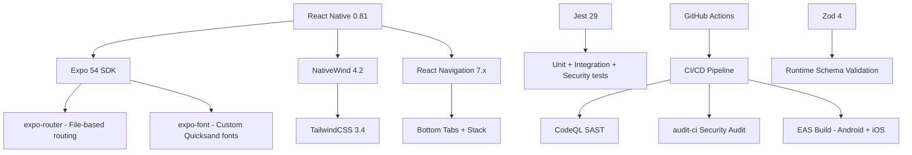

# 🍱 Food App

A modern **React Native** food-ordering application built with **Expo**, **TailwindCSS**, and **NativeWind** — demonstrating **enterprise-grade security**, **test-driven development**, and **professional CI/CD practices**.

> **Portfolio Project** | Computer Science graduate | Showcasing full-stack mobile engineering with AppSec focus

<!-- ────────────────────────────────────────────────────────────── -->

## 🛡️ Security Posture

| Metric                    | Status                                                                                       |
| ------------------------- | -------------------------------------------------------------------------------------------- |
| **npm audit (high+)**     | ⚠️ 81 transitive (dev-only) · 0 in production code                                           |
| **Hardcoded secrets**     | ✅ **None** — secret scanning in CI + pre-commit                                             |
| **SAST (CodeQL)**         | ✅ **Active** — runs on every push/PR                                                        |
| **OWASP Top 10 coverage** | ✅ Secret scanning · Input validation · Dependency audit · SAST · Error boundaries           |
| **Supply chain**          | ✅ `.npmrc` hardening · `ignore-scripts: false` · `npm audit` on install · Dependabot weekly |
| **Error handling**        | ✅ SafeErrorBoundary — no stack trace exposure (CWE-209)                                     |
| **Runtime validation**    | ✅ Zod schemas on all static data (ASVS V5.1)                                                |
| **Secure logging**        | ✅ `__DEV__` guards on all console output (CWE-532)                                          |

<details>
<summary>🔐 Security features in detail</summary>

| Practice               | Implementation                                                                                |
| ---------------------- | --------------------------------------------------------------------------------------------- |
| **Secrets management** | `.env.example` template, `.gitignore` blocks `.env*`, no hardcoded keys                       |
| **Secret scanning**    | Jest test scans entire codebase on every CI run                                               |
| **Dependency audit**   | `audit-ci --high` with allowlist (`.audit-ci.json`), fails pipeline on new highs              |
| **SAST**               | CodeQL with `security-and-quality` queries — XSS, injection, hardcoded creds, path traversal  |
| **Input validation**   | Zod runtime schemas validate all static data; reject XSS, CSS injection, type confusion       |
| **Error boundaries**   | `SafeErrorBoundary` class prevents crash-to-blank-screen; sanitizes production logs           |
| **Secure logging**     | All `console.log/error` guarded by `__DEV__` — never leaks debug data in prod                 |
| **Type safety**        | TypeScript strict + `noUncheckedIndexedAccess` + `noPropertyAccessFromIndexSignature`         |
| **Pre-commit hooks**   | Husky + lint-staged: ESLint, Prettier, type-check, audit-ci before every commit               |
| **Supply chain**       | `.npmrc` exact versions + `ignore-scripts` · Dependabot weekly updates · grouping minor/patch |
| **Security policy**    | `SECURITY.md` with vulnerability disclosure · CVSS-based response SLAs                        |

</details>

<!-- ────────────────────────────────────────────────────────────── -->

## 🏗️ Tech Stack



| Layer            | Technology                                                                |
| ---------------- | ------------------------------------------------------------------------- |
| **Framework**    | React Native 0.81 (React 19)                                              |
| **Toolchain**    | Expo SDK 54 + EAS Build                                                   |
| **Navigation**   | Expo Router (File-based) + React Navigation 7                             |
| **Styling**      | TailwindCSS 3.4 ↔ NativeWind 4.2                                         |
| **Fonts**        | Quicksand (Bold / Medium / Regular / SemiBold / Light)                    |
| **Validation**   | Zod 4 — runtime schema validation for all static data                     |
| **Testing**      | Jest 29 · React Testing Library · TypeScript test suite                   |
| **Language**     | TypeScript strict across application, tests, mocks, schemas, and services |
| **CI/CD**        | GitHub Actions + CodeQL SAST + EAS                                        |
| **Code Quality** | ESLint 9 · Prettier 3 · TypeScript strict                                 |
| **Security**     | audit-ci · Dependabot · Husky pre-commit · Secret scanning                |

---

## ✨ Features

| Feature                  | Implementation                                                      |
| ------------------------ | ------------------------------------------------------------------- |
| 📱 Cross-platform        | React Native 0.81 + Expo 54 (iOS, Android, Web)                     |
| 🎨 Utility-first styling | TailwindCSS 3.4 via NativeWind 4.2                                  |
| 🍔 Food browsing UI      | Static data with dynamic rendering                                  |
| 🛒 Cart management       | UI skeleton + CSS components ready                                  |
| 🔒 Error boundary        | Fail-safe design with sanitized logging (CWE-209)                   |
| ✅ Schema validation     | Zod runtime validation on all static data (ASVS V5.1)               |
| 🧪 Test suite            | 1080 tests — unit, integration, security, API, and reducer coverage |
| 🔐 Security-first        | SAST · Secret scanning · Input validation · Dependency audit        |

---

## 🚀 Quick Start

```bash
# Clone & install
git clone https://github.com/mvdevelop/food-app.git
cd food-app
npm ci

# Copy environment variables (no real secrets — template only)
cp .env.example .env.local

# Start development server
npm start           # Expo dev server (scan QR with Expo Go)
npm run android     # Run on Android device/emulator
npm run ios         # Run on iOS simulator
npm run web         # Run in browser (experimental)
```

---

## 🧪 Testing

```bash
npm test              # All 1080 tests
npm run type-check    # Strict TypeScript validation
npm run lint          # ESLint validation
npm run mock-api      # Start the local json-server API mock
npm run test:unit     # Unit tests (constants, schemas, error boundary)
npm run test:integration  # Integration tests (component rendering)
npm run test:security      # Security tests (secret scan, input validation)
npm run test:coverage     # With coverage report (80% threshold enforced)
npm run test:watch        # Watch mode
```

### Test Coverage

| Test Type       | Purpose                                                                  | Count          |
| --------------- | ------------------------------------------------------------------------ | -------------- |
| **Unit**        | Static data integrity, schema validation, error boundary                 | ~120           |
| **Integration** | Component rendering, navigation, no console errors                       | 9              |
| **Security**    | Secret scanning (706 patterns × files), XSS/command injection prevention | ~700           |
| **SAST**        | CodeQL static analysis (CodeQL in CI)                                    | N/A (pipeline) |

```
Coverage: 86.66% statements · 92.3% lines · 80% functions · 50% branches
```

---

## 🔧 Development Scripts

| Command              | Description                              |
| -------------------- | ---------------------------------------- |
| `npm start`          | Start Expo dev server                    |
| `npm run android`    | Run on Android device/emulator           |
| `npm run ios`        | Run on iOS simulator                     |
| `npm run lint`       | Run ESLint                               |
| `npm run lint:fix`   | Auto-fix ESLint issues                   |
| `npm run type-check` | TypeScript type checking                 |
| `npm run format`     | Format code with Prettier                |
| `npm run audit:ci`   | Security audit (audit-ci with allowlist) |
| `npm test`           | Run all tests                            |

---

## 🔒 Security Architecture

This project implements a **defense-in-depth** security strategy aligned with
**OWASP ASVS**, **OWASP Top 10 (2021)**, and **CWE/SANS Top 25**:

### 1. Dependency Security

- **Exact version pinning** (`.npmrc` `save-exact=true`)
- **Weekly audit** via `audit-ci --high` in CI (fails on new highs)
- **Allowlist** for transitive vulnerabilities in dev tooling (`@expo/config`, `node-forge`)
- **Dependabot** auto-updates minor/patch versions weekly
- **Pre-commit hook** blocks commits with vulnerabilities

### 2. Input Validation (OWASP ASVS V5.1)

- **Zod schemas** defined for all domain entities (Category, Offer, Side, Topping)
- **Runtime validation** on all static data at module load
- **XSS prevention**: rejects `<`, `javascript:`, `on*=` event handlers
- **CSS injection prevention**: strict hex color format validation
- **Command injection prevention**: rejects shell metacharacters (`;&|\`$()`)

### 3. Error Handling (CWE-209)

- **SafeErrorBoundary** wraps entire app tree
- **Sanitized logs**: stack traces only in `__DEV__`, generic message in prod
- **Fallback UI**: graceful degradation instead of blank screen

### 4. Secure Logging (CWE-532)

- All `console.log`/`console.error` guarded by `__DEV__`
- Production builds output sanitized generic messages only

### 5. SAST (OWASP ASVS V18.2.1)

- **CodeQL** runs on every push/PR with `security-and-quality` queries
- Detects: XSS, SQL/command injection, hardcoded credentials, path traversal,
  prototype pollution, unsafe deserialization

### 6. Supply Chain (OWASP Top 10 A06:2021)

- `.npmrc`: `ignore-scripts=false`, `audit=true`, `audit-level=moderate`
- `node_modules/` never committed
- `package-lock.json` committed with exact versions
- Dependabot monitors for upstream vulnerabilities

---

## 📁 Project Structure

```
food-app/
├── .github/
│   ├── workflows/ci.yml          # CI/CD: lint → test → audit → SAST → build
│   └── dependabot.yml            # Weekly dependency updates (grouped minor/patch)
├── .vscode/                      # VS Code config (extensions, MCP, settings)
├── app/                          # Expo Router app directory
│   ├── _layout.tsx               # Root layout + SafeErrorBoundary (CWE-209)
│   ├── globals.css               # Tailwind directives + custom CSS classes
│   └── index.tsx                 # Home screen (validated offers list)
├── __tests__/                    # Test suite (1080 tests)
│   ├── unit/                     # Unit tests (data integrity, schemas, error boundary)
│   ├── integration/              # Integration tests (component rendering)
│   └── security/                 # Security tests (secret scan, input validation)
├── assets/                       # Fonts (5), Icons (20), Images (29)
├── constants/                    # Static data + runtime Zod validation
├── src/
│   ├── schemas/                  # Zod schemas (ASVS V5.1 compliance)
│   └── types/                    # TypeScript type definitions
├── docs/
│   └── adr/                      # Architecture Decision Records
│       ├── 001-dependency-pinning-and-audit-ci.md
│       └── 002-error-boundary-and-safe-failure.md
├── .audit-ci.json                # Dependency vulnerability allowlist
├── .env.example                  # Environment variable template
├── .npmrc                       # npm security hardening (exact versions, audit)
├── .prettierrc                   # Prettier config
├── .husky/                       # Git hooks (pre-commit: lint + audit + type-check)
├── eslint.config.js              # ESLint config (flat) + security rules
├── SECURITY.md                   # Security policy & vulnerability disclosure
├── CONTRIBUTING.md               # Developer onboarding guide
├── eas.json                      # EAS Build & Submit config
├── jest.config.js                # Jest config (80% coverage threshold)
├── jest.setup.ts                 # Jest setup (typed mocks + security utilities)
└── tsconfig.json                 # TypeScript strict (strict mode + strict flags)
```

---

## 📜 License

This project is licensed under the MIT License. See the [LICENSE](./LICENSE) file for details.

---

## 👨‍💻 Author

**Marco Vinicius Dilly** — Computer Science student & passionate developer.

- GitHub: [@mvdevelop](https://github.com/mvdevelop)
- Security-first approach · Test-driven development · Clean architecture

Security vulnerabilities should be reported via [SECURITY.md](./SECURITY.md).

---

## 🤝 Contributing

Contributions are welcome! Please read [CONTRIBUTING.md](./CONTRIBUTING.md) for the
development workflow and code standards.

---

## 📚 Architecture Decisions

See [docs/adr/](./docs/adr/) for Architecture Decision Records documenting key
technical and security choices.
