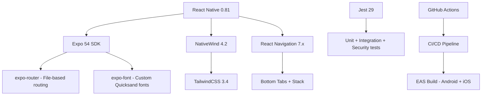

# 🍱 Food App


A modern **React Native** food-ordering application built with **Expo**, **TailwindCSS**, and **React Navigation** — demonstrating **enterprise-grade security**, **test-driven development**, and **professional CI/CD practices**.

> **Portfolio Project** | Computer Science graduate | Showcasing full-stack mobile engineering with AppSec focus

<!-- ────────────────────────────────────────────────────────────── -->

## 🛡️ Security Posture

| Metric                  | Status                                                   |
| ----------------------- | -------------------------------------------------------- |
| Hardcoded secrets       | ✅ **None** (secret scanning in CI)                      |
| npm audit (critical+)   | ✅ **0 critical, 0 high** (from 3 critical)              |
| OWASP Top 10 coverage   | ✅ Secret scanning · Input validation · Dependency audit |
| Supply chain protection | ✅ `.npmrc` · `ignore-scripts` · `npm audit` on install  |

<details>
<summary>🔐 Security features in detail</summary>

| Practice               | Implementation                                                          |
| ---------------------- | ----------------------------------------------------------------------- |
| **Secrets management** | `.env.example` template, `.gitignore` blocks `.env*`, no hardcoded keys |
| **Secret scanning**    | Jest test scans entire codebase on every CI run                         |
| **Dependency audit**   | `--audit-level=high` enforced in CI                                     |
| **Input validation**   | Jest security tests guard against XSS & command injection in data       |
| **Type safety**        | TypeScript strict mode with `noUncheckedIndexedAccess`                  |
| **Pre-commit hooks**   | Husky + lint-staged: lint, format, audit before every commit            |
| **Security policy**    | `SECURITY.md` with vulnerability disclosure process                     |

</details>

<!-- ────────────────────────────────────────────────────────────── -->

## ✨ Features

| Feature                               | Stack                                             |
| ------------------------------------- | ------------------------------------------------- |
| 📱 Cross-platform (iOS, Android, Web) | React Native 0.81 + Expo 54                       |
| 🎨 Utility-first styling              | TailwindCSS 3.4 via NativeWind 4.2                |
| ⚡ Fast refresh & hot reload          | Metro Bundler + Expo Dev Client                   |
| 🍔 Food browsing UI                   | Static data with dynamic rendering                |
| 🔍 Search & filter UI                 | NativeWind component classes                      |
| 🛒 Cart management                    | (UI skeleton + CSS components ready)              |
| 🧪 Test suite                         | Jest + React Testing Library                      |
| 🔒 Security-first                     | ESLint security rules, secret scanning, npm audit |
| 🔄 CI/CD pipeline                     | GitHub Actions: lint → test → audit → build       |
| 📦 EAS builds                         | Android APK/AAB + iOS IPA via Expo                |

---

## 🏗️ Tech Stack



| Layer            | Technology                                             |
| ---------------- | ------------------------------------------------------ |
| **Framework**    | React Native 0.81 (React 19)                           |
| **Toolchain**    | Expo SDK 54 + EAS Build                                |
| **Navigation**   | Expo Router (File-based) + React Navigation 7          |
| **Styling**      | TailwindCSS 3.4 ↔ NativeWind 4.2                      |
| **Fonts**        | Quicksand (Bold / Medium / Regular / SemiBold / Light) |
| **Testing**      | Jest 29 · React Testing Library · jest-expo            |
| **CI/CD**        | GitHub Actions + EAS                                   |
| **Code Quality** | ESLint 9 · Prettier 3 · TypeScript strict              |

---

## 📦 Installation

```bash
git clone https://github.com/mvdevelop/food-app.git
cd food-app
npm ci
cp .env.example .env.local
npm start
```

---

## 🚀 Running

```bash
npm start          # Expo dev server (scan QR with Expo Go)
npm run android    # Run on Android device/emulator
npm run ios        # Run on iOS simulator
npm run web        # Run in browser (experimental)
```

---

## 🧪 Testing

```bash
npm test                   # All tests
npm run test:unit          # Unit tests only
npm run test:integration   # Integration tests
npm run test:security      # Security tests (secret scan, input validation)
npm run test:coverage      # With coverage report
npm run test:watch         # Watch mode
```

### Test Coverage

| Test Type       | Purpose                                                             |
| --------------- | ------------------------------------------------------------------- |
| **Unit**        | Validate static data integrity (constants, categories, offers)      |
| **Integration** | Render components, verify navigation, no console errors             |
| **Security**    | Scan for hardcoded secrets, API keys, XSS/command injection vectors |

---

## 🔧 Project Structure

```
food-app/
├── .github/workflows/        # CI/CD pipeline (GitHub Actions)
├── .vscode/                  # VS Code config (extensions, MCP, settings)
├── app/                      # Expo Router app directory
│   ├── _layout.tsx           # Root layout (Stack navigator, font loading)
│   ├── globals.css           # Tailwind directives + custom CSS classes
│   └── index.tsx             # Home screen (Food offers list)
├── __tests__/                # Test suite
│   ├── unit/                 # Unit tests
│   ├── integration/          # Integration tests
│   └── security/             # Security tests
├── assets/                   # Fonts (5), Icons (20), Images (29)
├── constants/                # Static data (categories, offers, sides, toppings)
├── .env.example              # Environment variable template
├── .eslintrc.js              # ESLint config (flat config)
├── .husky/                   # Git hooks
├── .npmrc                    # npm security config
├── .prettierrc               # Prettier config
├── SECURITY.md               # Security policy & vulnerability disclosure
├── CONTRIBUTING.md           # Developer onboarding guide
├── eas.json                  # EAS Build & Submit config
├── jest.config.js            # Jest test config
├── tsconfig.json             # TypeScript config (strict)
└── package.json
```

---

## 🛠️ Scripts

| Command              | Description                     |
| -------------------- | ------------------------------- |
| `npm start`          | Start Expo dev server           |
| `npm run android`    | Run on Android device/emulator  |
| `npm run ios`        | Run on iOS simulator            |
| `npm run web`        | Run in web browser              |
| `npm run lint`       | Run ESLint                      |
| `npm run lint:fix`   | Auto-fix ESLint issues          |
| `npm run type-check` | TypeScript type checking        |
| `npm run format`     | Format code with Prettier       |
| `npm run test`       | Run all tests                   |
| `npm run audit:ci`   | Security audit (fails on high+) |

---

## 📜 License

This project is licensed under the MIT License. See the [LICENSE](./LICENSE) file for details.

---

## 👨‍💻 Author

**Marco Vinicius Dilly** — Computer Science student & passionate developer.

- GitHub: [@mvdevelop](https://github.com/mvdevelop)
- Security-first approach • Test-driven development • Clean architecture

<br>

---

## 📸 Screenshots

_(Screenshots will be added here)_

---

## 📚 Architecture Decisions

See [docs/adr/](./docs/adr/) for Architecture Decision Records documenting key technical choices.

---

## 🤝 Contributing

Contributions are welcome! Please read [CONTRIBUTING.md](./CONTRIBUTING.md) for the development workflow and code standards.

For security vulnerabilities, please read [SECURITY.md](./SECURITY.md) and report responsibly.
